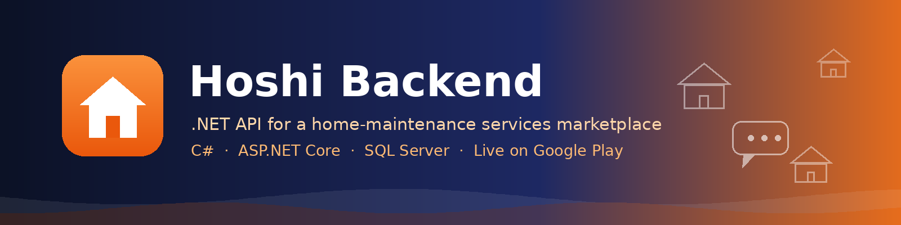

<!-- ═══════════════ HEADER ═══════════════ -->


<div align="center">

<a href="https://play.google.com/store/apps/details?id=com.hoshi.novixcode"></a>


<br/>

**The .NET backend behind Hoshi: a live marketplace app that connects homeowners with technicians for repairs and maintenance.**

[Overview](#-overview) · [The app](#-the-app) · [Backend](#%EF%B8%8F-what-the-backend-does) · [Flow](#-request-flow) · [Tech](#-tech-stack) · [Contact](#-contact)

</div>

---

## 🏠 Overview

**Hoshi** is a home-maintenance services app published on **[Google Play](https://play.google.com/store/apps/details?id=com.hoshi.novixcode)**. Customers request a service (electrical, plumbing, AC, cleaning, landscaping and more), technicians send **price quotes**, and the customer picks the best offer by **price or rating**. After that, the two chat **inside the app**, and payment is made **in cash** when the job is done.

I built the **backend with .NET**: the API that powers accounts, service requests, quotes, chat and ratings for the mobile app.

<table>
<tr>
<td align="center" width="25%">🛠️<br/><b>Services</b><br/><sub>Electrical, plumbing, AC, cleaning, gardening…</sub></td>
<td align="center" width="25%">💬<br/><b>Quotes</b><br/><sub>Technicians compete with offers</sub></td>
<td align="center" width="25%">🗨️<br/><b>Chat</b><br/><sub>Customer ↔ technician after acceptance</sub></td>
<td align="center" width="25%">⭐<br/><b>Ratings</b><br/><sub>Choose by price or reputation</sub></td>
</tr>
</table>

---

## 📱 The app

| | |
|---|---|
| **Name** | Hoshi |
| **Platform** | Android, live on Google Play |
| **Category** | Business: home maintenance marketplace |
| **My role** | **Backend developer (.NET)** |

<a href="https://play.google.com/store/apps/details?id=com.hoshi.novixcode"></a>

---

## ⚙️ What the backend does

<table>
<tr>
<td width="50%" valign="top">

### 👤 Accounts & roles
- Registration and sign-in
- Two roles: **customers** and **technicians**
- Profiles, and technician ratings

</td>
<td width="50%" valign="top">

### 🧰 Services & requests
- Service categories (electrical, plumbing, AC, cleaning, landscaping…)
- Create a request with a **description and photos**
- Request status from new to completed

</td>
</tr>
<tr>
<td width="50%" valign="top">

### 💰 Quotes / offers
- Technicians see requests and **send price quotes**
- The customer compares offers by **price and rating**
- The customer **accepts** one offer; the others close

</td>
<td width="50%" valign="top">

### 🗨️ Chat, completion & rating
- **In-app chat** opens between customer and technician after acceptance
- Job completion with **cash payment**
- The customer **rates** the technician

</td>
</tr>
</table>

---

## 🔄 Request flow

```
 Customer                         Hoshi .NET API                         Technician
 ────────                         ──────────────                         ──────────
 1. Choose service  ───────────▶  create request (+ photos)
                                  notify matching technicians ────────▶  2. View request
                                                               ◀────────  3. Send price quote
 4. Compare quotes  ◀───────────  list offers (price, rating)
 5. Accept offer    ───────────▶  assign technician, close others ─────▶  6. Job assigned
 7. Chat            ◀──────────▶  in-app messages              ◀──────▶  7. Chat
 8. Pay cash + rate ───────────▶  complete request, save rating
```

---

## 🧰 Tech stack

| Part | Technology |
|---|---|
| Language | **C#** |
| Framework | **ASP.NET Core Web API** |
| Database | **SQL Server** |
| Client | Android app (published on Google Play) |
| Communication | REST / JSON |

---

## 🔒 Availability

This is a **client project**. The source code is private. This repository is a showcase of the backend work.

---

## 📬 Contact

<div align="center">

<a href="https://www.linkedin.com/in/ahmed-toba-7378b0206/"></a>
<a href="mailto:ahmedtobashahban21@gmail.com"></a>

<br/><br/>

<sub>Backend by <a href="https://github.com/ahmedtobashahban21">Ahmed Toba Shaban</a></sub>

</div>


